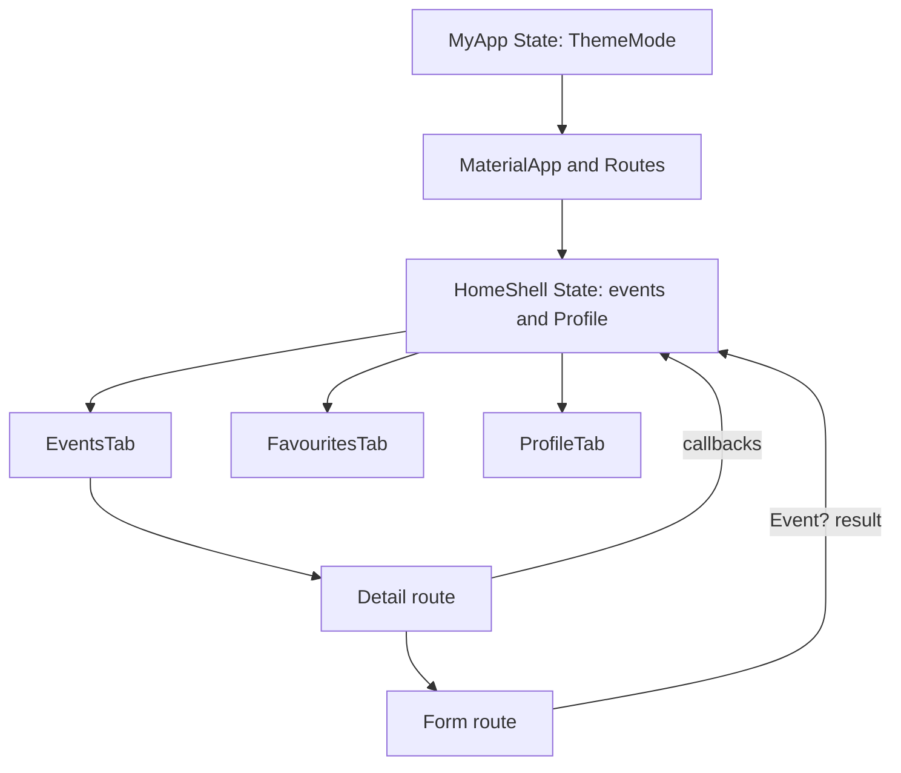

# Qadam Events Flutter Architecture

The coursework app is isolated in `flutter_app/`; the surrounding workspace and the separate Qadam project are preserved. The app uses immutable models and pure helpers, focused screens/widgets, and a rubric-compatible MVVM-inspired shell.

`HomeShell` owns the one in-memory event list and `Profile`, then passes both to all tabs with callbacks. This intentionally takes precedence over a strict ViewModel because the Lab_01 rubric requires shared state in the shell `State`. `MyApp` owns `ThemeMode` above `MaterialApp`, and Profile reports theme changes upward.

`Event` has final fields, an unmodifiable attendee view, and `copyWith`. A private const constructor enables const-compatible model construction while the public factory defensively copies arbitrary list inputs. The elapsed countdown treats an event as `Upcoming` before its start, `Started` during a two-hour window, and `Ended` afterwards. Named paths are centralized in `Routes`; typed route arguments let detail callbacks update shell state while forms return an `Event` to the shell. `LayoutBuilder` calculates grid columns so cells stay within 360 px. `PopScope` compares every editable value with the opening snapshot, including category, mode, date/time, and limit.

The seed set intentionally includes an exact 60-character title, a full robotics tour, a past retrospective, two valid online links, and an event with a null description. Dates are calculated from the current time so the sample remains useful after the coursework is submitted, and each `seedEvents()` call constructs fresh event objects and attendee lists.
